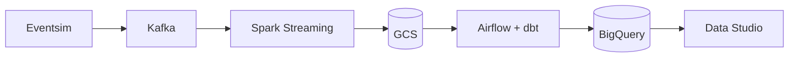
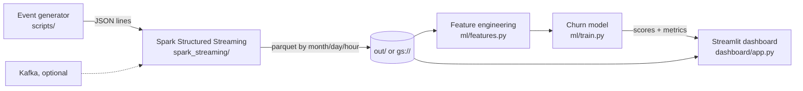

# churnstream

A streaming analytics pipeline that runs end to end on a laptop, with a **churn prediction model** and a **live dashboard** on top.

Forked from [ankurchavda/streamify](https://github.com/ankurchavda/streamify) (Kafka, Spark Streaming, dbt, Airflow, Terraform on GCP). The upstream project is credited here and its commit history is kept; the original README is in [`docs/ORIGINAL_README.md`](docs/ORIGINAL_README.md).

## Flow

**Upstream (GCP only):**



**churnstream (this repo):**



## What I added

- **Local mode:** Spark runs on `local[*]` and writes parquet to disk. Kafka is optional (`SOURCE=file`). Config via env vars (`SPARK_MASTER`, `STORAGE_PATH`, `TRIGGER_INTERVAL`, `RUN_SECONDS`); defaults still match the original GCP/YARN setup.
- **Data generator:** simulated users who gradually disengage before cancelling, so the model has a real signal to learn.
- **Churn model (`ml/`):** features are built from events before a cutoff and the label from events after it, so there is no leakage. Logistic regression vs gradient boosting, with a hold-out set and 5-fold CV.
- **Dashboard (`dashboard/app.py`):** KPIs, listens by day and hour, top songs, page mix, churn-risk distribution, top features, highest-risk users.
- **Bug fix:** the `string_decode` UDF crashed the stream on real unicode; it now falls back safely.
- **Tests and Makefile:** `make all` runs the whole pipeline.

## Run it (no Docker, no GCP)

Python 3.9+ and Java 11/17.

```bash
python3 -m venv .venv && source .venv/bin/activate
make install
unset SPARK_HOME      # Homebrew's Spark clashes with pip's pyspark
make all              # generate -> stream (~1 min) -> train
make dashboard        # http://localhost:8501
make test
```

## Results

On 300 simulated users over 14 days the best model reaches ROC-AUC about 0.94 (hold-out) and 0.93 (5-fold CV). The churn signal is built into the generator, so this shows the pipeline works, not real-world accuracy. My first version scored 1.0, which told me the fake data was too easy, so I added noise.

## Kafka and GCP

- **Kafka:** drop `SOURCE=file`, start a broker with `kafka/docker-compose.yml`, and submit with `--packages org.apache.spark:spark-sql-kafka-0-10_2.12:3.5.3`. Something still has to produce events into `listen_events`, `page_view_events`, `auth_events`.
- **GCP:** with `STORAGE_PATH` unset the job writes to `gs://$GCP_GCS_BUCKET` like upstream. `pip install -r requirements-gcp.txt` lets `ml/` and the dashboard read `gs://`. Terraform, Airflow and dbt are unchanged.
- **Not tested yet:** the Kafka and GCP paths. Only the local path has been run.

## Next

Kafka producer with a slimmed docker-compose, dbt on DuckDB, scheduled retraining.

---
*Developed with AI assistance (Claude).*
